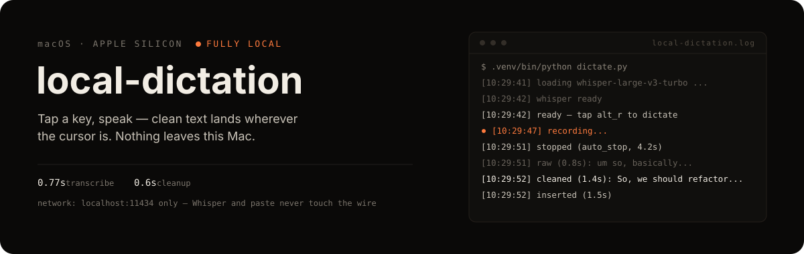
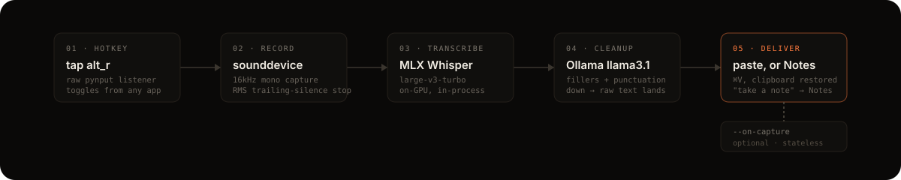

<p align="center">
  
</p>

Fully local Wispr Flow clone for macOS (Apple Silicon). Tap a hotkey, speak,
tap again (or pause ~2 s) — cleaned-up text lands in whatever field has focus.
Whisper (MLX, on-GPU) transcribes; Ollama removes filler words and fixes
punctuation. The only network traffic is `localhost:11434`.

## How it works

<p align="center">
  
</p>

Routing (the "take a note" check) runs on the raw transcript, before cleanup —
otherwise cleanup could reword the hot phrase away. If Ollama is unreachable,
cleanup is skipped and the raw transcript is still delivered; dictation never
hard-fails on that leg. Full threading and deployment diagrams live in
[`docs/architecture/README.md`](docs/architecture/README.md); the tradeoffs
behind each component are in [`PLAN.md`](PLAN.md).

## Run it

```sh
cd ~/Workspace/dev/tools/local-dictation
.venv/bin/python dictate.py
```

Wait for `ready — tap alt_r to dictate`, then in any app: tap **right Option**,
speak, tap again or just pause. Tink on start, Pop on stop.

Start the utterance with **"take a note"** or **"note to self"** and it's sent
to macOS Notes instead of pasted — created in the background, focus never
leaves your current app, Glass sound on success.

## First-run permissions

Grant these to the terminal app you run it from (System Settings → Privacy &
Security), then restart the daemon:

- **Microphone** — prompted automatically on first recording
- **Input Monitoring** — prompted automatically for the global hotkey
- **Accessibility** — add manually if text never appears (needed for the synthetic ⌘V)

## Run at login + menu-bar control

Two launchd agents, installed by copying both plists to `~/Library/LaunchAgents/`
and `launchctl bootstrap gui/$UID <plist>` each (opt-in — the daemon has mic +
Input Monitoring access):

- `com.nino.local-dictation.plist` — the dictation daemon (`dictate.py`)
- `com.nino.local-dictation.menubar.plist` — the tray app (`menubar.py`): a
  ◉/○ menu-bar icon with Start / Stop / Open Log / Quit. It drives the
  daemon's launchd job via `launchctl` rather than owning the process, so
  launchd stays the single owner (crash-restart, logging) and the tray needs
  no permissions of its own. Quit keeps it quit until next login.

Manual control (same thing the tray does):

```sh
launchctl bootout gui/$UID/com.nino.local-dictation      # stop
launchctl bootstrap gui/$UID ~/Library/LaunchAgents/com.nino.local-dictation.plist  # start
```

Status and logs: `launchctl print gui/$UID/com.nino.local-dictation`,
`~/Library/Logs/local-dictation.log` (daemon), `local-dictation-menubar.log` (tray).

Permissions caveat: under launchd there's no hosting terminal, so macOS
attributes the TCC prompts to the `.venv` python binary itself — expect fresh
Microphone / Input Monitoring / Accessibility prompts on first launchd run
even if your terminal already has grants. The plist restarts the daemon on
crash (`KeepAlive.SuccessfulExit=false`); Ollama being down is fine — the
daemon inserts raw transcripts until it returns.

## Options

```
--key alt_r          toggle key (any pynput name: cmd_r, f13, ...)
--model llama3.1     Ollama model for the cleanup pass
--whisper mlx-community/whisper-large-v3-turbo   MLX whisper repo id
--no-cleanup         insert the raw transcript, skip Ollama
--no-auto-stop       only the hotkey stops recording
--silence-secs 2.0   trailing silence before auto-stop
--threshold 0.015    RMS speech threshold
--language en        spoken language
--on-capture CMD     capture seam: CMD gets one JSON event on stdin per dictation
--test-file f.wav    pipeline check without mic/hotkey (prints instead of pastes)
```

## Capture seam

`--on-capture` pipes one JSON object per delivered dictation to your command's
stdin, fire-and-forget (10s timeout, failures logged, never blocks dictation):

```json
{"ts":"2026-07-03T10:29:42-0500","route":"note","raw":"um take a note, ...",
 "text":"...","duration_s":4.2,"app":"com.cmuxterm.app"}
```

`route` is `paste` or `note`; `raw` is the verbatim transcript, `text` what was
delivered; `app` is the frontmost bundle id when you started speaking. The
daemon stores nothing — consumers own storage and schema (see `PLAN.md`'s
product boundary). Example consumer: `--on-capture 'cat >> ~/notes/dictation.jsonl'`.
To use it with the launchd daemon, add the flag to `ProgramArguments` in the
plist and kickstart.

## Setup

```sh
uv venv --python 3.13 .venv
uv pip install --python .venv/bin/python mlx-whisper sounddevice pynput rumps
```

ffmpeg via Homebrew. First use of a new `--whisper` model downloads weights
from Hugging Face; after that the daemon sets `HF_HUB_OFFLINE=1` and runs
fully offline.

## Notes

- Text insertion goes through the clipboard (paste is reliable where synthetic
  typing is not). Your previous clipboard **text** is restored afterward;
  non-text clipboard content (images) is not.
- If tapping right Option does nothing even after granting Input Monitoring
  (some keyboards remap it), pick another key: `--key f13` or `--key cmd_r`.
