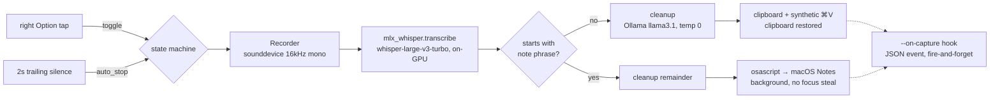
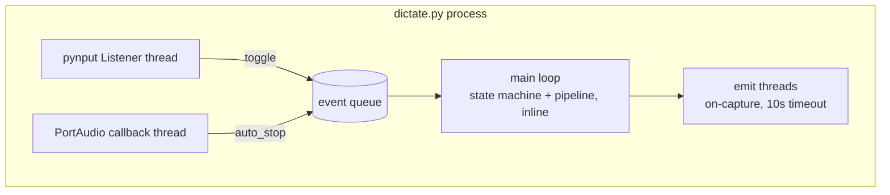
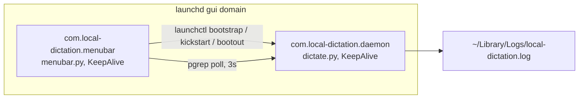

# Architecture

Single-process Python daemon plus a menu-bar control app, deployed as two
launchd agents. Decisions and their rationale live in [PLAN.md](../../PLAN.md);
this page is the structural view.

## Runtime pipeline

Cleanup degrades gracefully: if Ollama is unreachable, the raw transcript is
delivered. Routing runs on the raw transcript because cleanup may reword the
hot phrase. The cleanup prompt is injection-hardened (transcript wrapped in
`<transcript>` tags, model forbidden from answering it) — without this,
question-shaped dictation gets answered instead of cleaned.

## Threading model

The pipeline runs inline in the main loop (~1.5s warm); toggles queued during
processing are drained afterwards so a stray tap can't start a phantom
recording.

## Deployment topology

The tray never owns the daemon process — launchd is the single owner
(crash-restart, logging); the tray is a control plane and therefore needs no
TCC permissions. The daemon's TCC grants (Microphone, Accessibility, Input
Monitoring) attach to the resolved Homebrew Python binary; a Python upgrade
invalidates them (symptom: "This process is not trusted!" in the log).

## Privacy boundary

No non-localhost traffic at runtime: Whisper runs in-process (weights cached,
`HF_HUB_OFFLINE=1`), cleanup talks only to `localhost:11434`, audio lives in
memory only, and the daemon stores nothing — the `--on-capture` seam hands
events to external consumers who own storage and schema (see PLAN.md
"Product boundary").
